### AI × 电商 × 自动化

**从一个想法，到一套能运转的系统。**

电商运营 · AI Agent · 工作流自动化 · 自托管基础设施

[ABOUT](#01--about--关于我) &nbsp; / &nbsp; [EXPLORE](#02--explore--探索方向) &nbsp; / &nbsp; [STACK](#03--stack--工具箱) &nbsp; / &nbsp; [CONNECT](#05--connect--联系我)

---

## 01 / ABOUT · 关于我

我关注 **AI、电商与自动化的结合**，探索从日常运营、数据处理到内容生产的工作流，也折腾 Docker、NAS 和自托管工具。

> 凡是值得做两次的事，就值得自动化。

希望把零散的工具连接起来，让流程更顺畅，让时间留给判断与创造。

## 02 / EXPLORE · 探索方向

| 方向 | 关注的具体问题 |
| :--- | :--- |
| **电商运营** | 运营流程自动化、数据整理与分析、智能选品 |
| **AI Agent** | 多 Agent 协作、LLM 编排、工具调用与任务执行 |
| **图像工作流** | ComfyUI 节点编排、批量出图与风格控制 |
| **自托管部署** | Docker 容器、NAS 服务与 Homelab 工具链 |
| **效率工具** | 用脚本连接工具，减少重复操作与手动搬运 |

## 03 / STACK · 工具箱

## 04 / ACTIVITY · 贡献足迹

<picture>
  <source media="(prefers-color-scheme: dark)" srcset="https://raw.githubusercontent.com/liudali333/liudali333/output/github-snake-dark.svg" />
  
</picture>

## 05 / CONNECT · 联系我

欢迎交流 **电商自动化、AI Agent、ComfyUI 与 NAS 部署**。

扫码添加微信 · 交流想法与实践

  

